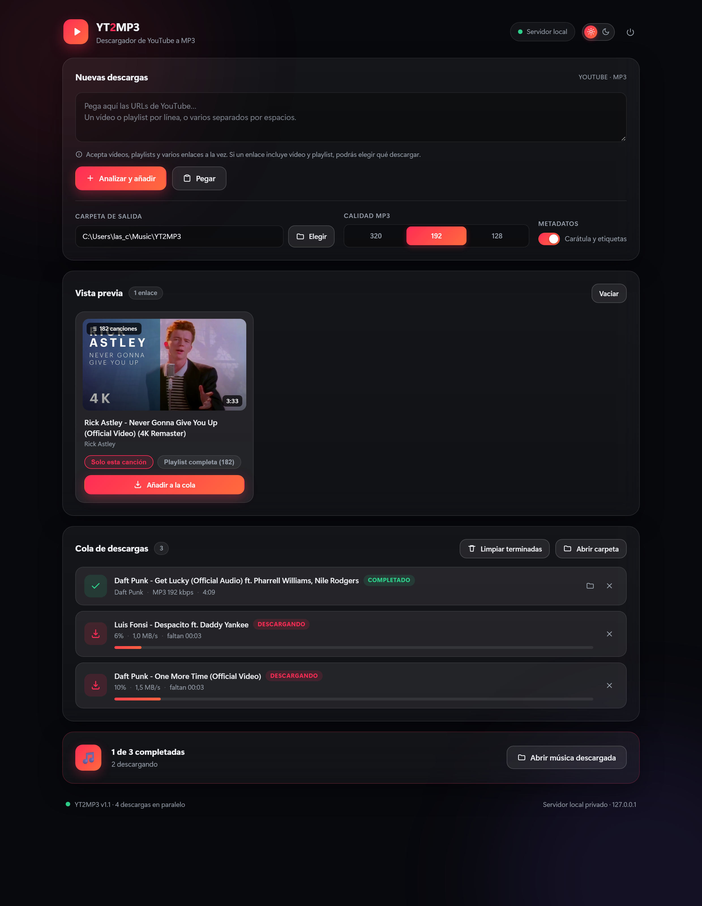
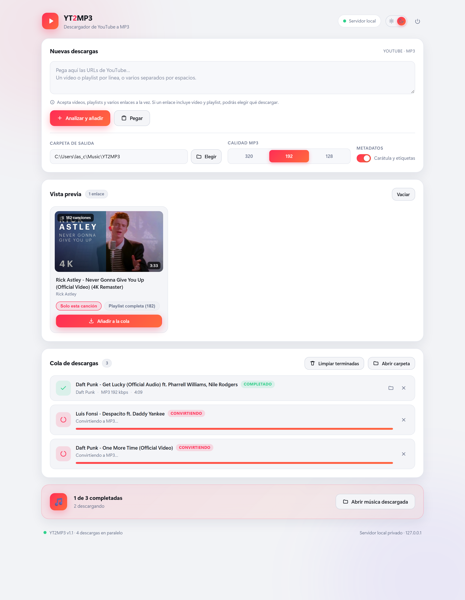
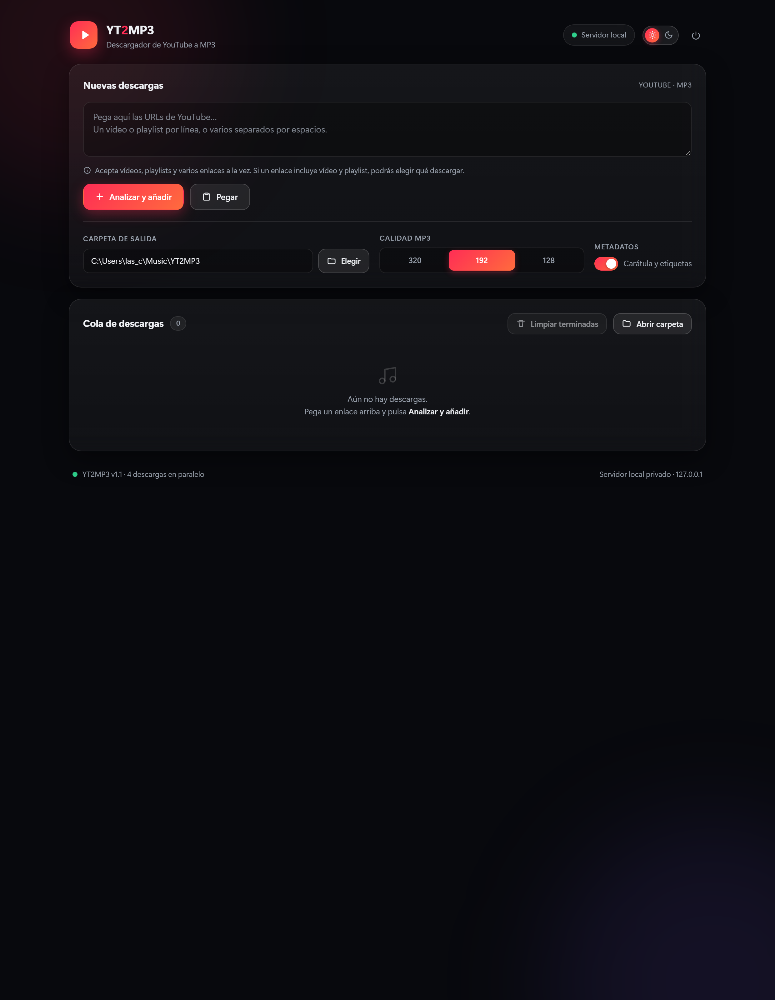

# YT2MP3 — Descargador de YouTube a MP3

Descarga vídeos y playlists de YouTube como **MP3** desde una interfaz moderna en tu navegador.
Sin terminal, sin cuentas y sin subir nada a internet: la aplicación corre en tu propio PC.



## ¿Qué incluye?

- **Interfaz web local** que se abre sola en tu navegador (Chrome, Edge, Firefox…)
- **Varios enlaces a la vez**: pega todas las URLs que quieras y se analizan en paralelo
- **Vista previa** con miniatura, título, canal y duración
- Si un enlace incluye **vídeo + playlist**, eliges *solo esta canción* o la *playlist completa*
- **Cola de descargas** con progreso en vivo (porcentaje, velocidad y tiempo restante)
- Cancelar, reintentar y limpiar descargas terminadas
- **Calidad MP3** seleccionable: 320, 192 o 128 kbps
- **Carátula y etiquetas** incrustadas en el MP3 (título, artista y portada)
- **Carpeta de salida** a tu gusto, con el selector nativo de Windows
- **Tema oscuro y claro** con un interruptor (recuerda tu elección)
- Hasta **4 descargas en paralelo**
- Botón **Salir** que apaga la aplicación limpiamente

| Modo oscuro | Modo claro |
|---|---|
|  |  |

## Instalación en 3 pasos

1. Descarga el proyecto: botón verde **Code → Download ZIP** y descomprímelo donde quieras
   (por ejemplo, en tu carpeta de usuario).
2. Entra en la carpeta y haz doble clic en **`instalar.bat`**.
3. Espera a que termine. En el escritorio aparecerán **dos iconos** listos para usar.

El instalador se encarga de todo por ti:

- Instala **Python** si no está en el equipo (sin permisos de administrador)
- Crea un **entorno virtual** con **yt-dlp**
- Descarga **FFmpeg** en la carpeta del proyecto (necesario para convertir a MP3)
- Crea los **accesos directos** del escritorio con sus iconos

> 💡 Si Windows muestra *"Windows protegió tu PC"* (SmartScreen) al ejecutar el instalador,
> pulsa **Más información → Ejecutar de todas formas**. Es el aviso estándar para archivos
> recién descargados y no significa que haya un problema.

La primera instalación descarga unos **110 MB** (Python y FFmpeg). Las siguientes veces
`instalar.bat` solo actualiza yt-dlp, así que tarda unos segundos.

## Los dos iconos del escritorio

| Icono | Qué hace | Para quién |
|---|---|---|
| **YT2MP3** | Abre la interfaz web en tu navegador | La forma fácil y recomendada |
| **YT2MP3 (Terminal)** | Abre la versión clásica en una ventana de texto | Quien prefiera pegar URLs y pulsar Enter |

Los dos usan el mismo motor de descarga y la misma carpeta de música. Puedes usar el que
más te guste, o ambos.

La primera vez que abras la interfaz web verás la pantalla de bienvenida:



## Cómo se usa la interfaz web

### 1. Pega tus enlaces

Copia una o varias URLs de YouTube y pégalas en el cuadro de texto (una por línea o
separadas por espacios). Después pulsa **Analizar y añadir** (o `Ctrl + Enter`).

### 2. Elige qué descargar

Cada enlace aparece como una tarjeta con su miniatura. Si la URL contiene un vídeo dentro
de una playlist, verás dos opciones:

- **Solo esta canción** — descarga únicamente ese vídeo
- **Playlist completa (N)** — descarga las N canciones de la lista

Pulsa **Añadir a la cola** en las tarjetas que quieras descargar.

### 3. Sigue la cola

La cola muestra cada descarga con su estado: *En espera*, *Descargando*, *Convirtiendo*,
*Completado* o *Error*.

- Mientras descarga verás el **porcentaje, la velocidad y el tiempo restante**
- En playlists también se indica **qué canción va** (por ejemplo, *Canción 4 de 18*)
- Puedes **cancelar** una descarga en curso o **reintentar** las que fallen
- **Abrir carpeta** lleva directamente a tus MP3
- **Limpiar terminadas** quita de la lista las descargas acabadas

### 4. Ajusta a tu gusto

Antes de añadir canciones puedes cambiar:

- **Carpeta de salida** con el botón **Elegir** (se abre el selector de Windows)
- **Calidad MP3**: 320, 192 o 128 kbps
- **Carátula y etiquetas**: si lo dejas activado, el MP3 incluye la portada del vídeo,
  el título y el artista

Los ajustes se guardan y se recuerdan la próxima vez.

### 5. Cierra cuando termines

El botón de apagado (arriba a la derecha) detiene el servidor y libera el puerto. Si solo
cierras la pestaña, la aplicación sigue en segundo plano; puedes volver a abrirla con el
icono **YT2MP3** del escritorio.

## ¿Dónde se guardan los MP3?

Por defecto, en la carpeta **`Música descargada`** dentro de la propia carpeta del programa.
Puedes cambiarla en cualquier momento con el botón **Elegir** de la interfaz.

Los nombres de archivo se limpian automáticamente para que Windows no tenga problemas con
caracteres no permitidos. En las playlists, los archivos se numeran para conservar el orden.

## Actualizar

YouTube cambia con frecuencia, así que yt-dlp necesita actualizarse de vez en cuando.
Vuelve a ejecutar **`instalar.bat`**: actualizará las librerías sin repetir las descargas
grandes (Python y FFmpeg) y volverá a crear los iconos.

## Desinstalar

No hay desinstalador porque la app vive en su propia carpeta:

1. Borra la carpeta del proyecto (incluye el entorno y los MP3 si los guardaste ahí).
2. Borra los iconos **YT2MP3** y **YT2MP3 (Terminal)** del escritorio.

El resto del sistema queda intacto.

## Problemas frecuentes

**Al hacer doble clic en el icono no pasa nada**
Espera unos segundos: la primera vez el servidor tarda en arrancar. Si sigue igual, abre
`lanzar_app.bat` desde la carpeta del proyecto para ver el mensaje de error y revisa el
archivo `yt2mp3.log`, que guarda todos los detalles.

**Dice que falta FFmpeg**
Cierra la app y vuelve a ejecutar `instalar.bat`. La conversión a MP3 necesita FFmpeg.

**YouTube pide verificación ("Sign in to confirm you're not a bot")**
YouTube limita algunas descargas automáticas según el vídeo y tu conexión. La app ya lo
intenta sola: si el cliente normal falla, reintenta con un cliente alternativo de yt-dlp.

Si el aviso sigue apareciendo:

1. Espera unos minutos y vuelve a intentarlo (el bloqueo suele ser temporal).
2. Actualiza con `instalar.bat` (YouTube cambia a menudo y yt-dlp se adapta).
3. Como solución definitiva, exporta las cookies de YouTube a un archivo **`cookies.txt`**
   en la carpeta del proyecto. Puedes usar una extensión del navegador como
   *Get cookies.txt LOCALLY*: inicia sesión en YouTube, exporta las cookies y guarda el
   archivo con ese nombre exacto junto a `app.py`. La app lo detectará automáticamente.
   Ese archivo da acceso a tu cuenta: no lo compartas ni lo subas a internet (ya está
   excluido de Git).

**Dice que el vídeo no está disponible**
Puede ser un vídeo privado, eliminado o bloqueado en tu país. El mensaje de la propia app
indica el motivo concreto.

**El navegador no se abre solo**
Entra manualmente en [http://127.0.0.1:8123](http://127.0.0.1:8123) mientras la app está
en marcha. Si ese puerto estuviera ocupado, la app usa el siguiente libre (8124, 8125…).

**Windows Defender o el antivirus avisa**
Es habitual con programas que descargan contenido de internet. Si confías en el proyecto,
añade la carpeta a las exclusiones. El código es abierto y puedes revisarlo completo.

## Privacidad

La interfaz se sirve **solo en tu equipo** (`127.0.0.1`), no se abre a la red local ni a
internet. No hay cuentas, analítica ni telemetría. Las únicas conexiones externas son las
de YouTube (para descargar) y GitHub/python.org durante la instalación.

## Desarrollo

Si prefieres ejecutar el proyecto a mano, sin el instalador:

```bash
python -m venv .venv
.venv\Scripts\pip install -r requirements.txt
.venv\Scripts\python app.py      # interfaz web en http://127.0.0.1:8123
.venv\Scripts\python yt2mp3.py   # versión de terminal
```

Requisitos: **Python 3.9+** y **FFmpeg** en el `PATH` o en la carpeta `ffmpeg\` del proyecto.

La interfaz no necesita compilación: es HTML, CSS y JavaScript servidos por el propio
backend (sin Node, sin npm). El backend usa solo la biblioteca estándar de Python y yt-dlp.

## Estructura

| Archivo | Descripción |
|---|---|
| `instalar.bat` | Instalador automático para Windows (dependencias + iconos) |
| `app.py` | Servidor local de la interfaz web y API de descargas |
| `downloader.py` | Lógica compartida con yt-dlp (analizar, descargar, progreso) |
| `web/index.html` | Interfaz web |
| `web/styles.css` | Estilos (temas oscuro y claro) |
| `web/app.js` | Lógica de la interfaz (cola, vista previa, ajustes) |
| `lanzar_app.bat` | Lanzador manual de la interfaz web |
| `yt2mp3.py` | Versión de terminal |
| `yt2mp3.bat` | Lanzador de la versión de terminal |
| `requirements.txt` | Dependencias de Python (yt-dlp) |
| `icon.ico` | Icono del acceso directo web |
| `icon_terminal.ico` | Icono del acceso directo de terminal |
| `cookies.txt` | Opcional: cookies de YouTube si la app pide verificación |
| `docs/` | Capturas usadas en este README |

## Aviso legal

Descarga únicamente contenido propio, de dominio público o para el que tengas permiso.
El uso de esta herramienta para descargar contenido protegido puede infringir los términos
de servicio de YouTube y las leyes de propiedad intelectual de tu país. El proyecto no
alberga ni distribuye contenido: solo automatiza una descarga que tú decides hacer.

## Licencia

Consulta el archivo [LICENSE](LICENSE).
